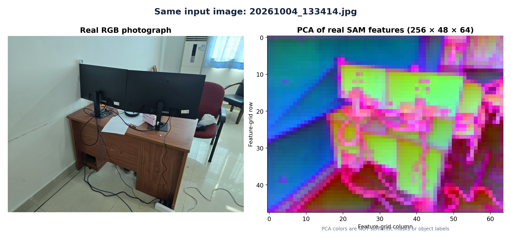
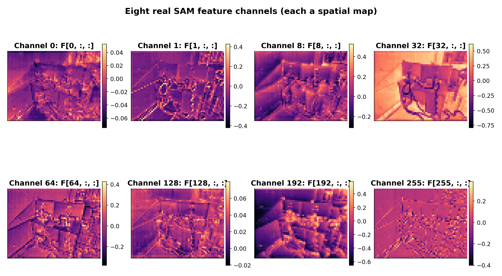
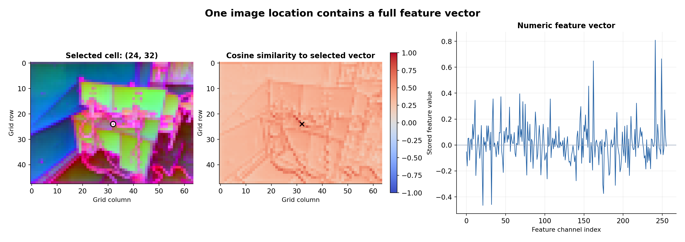
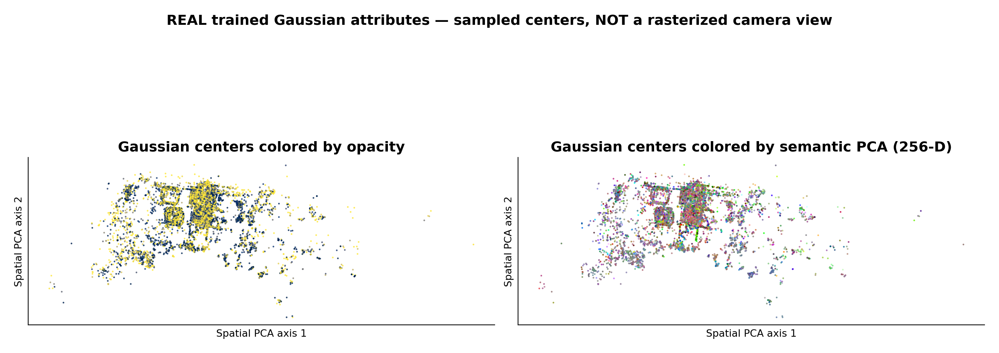
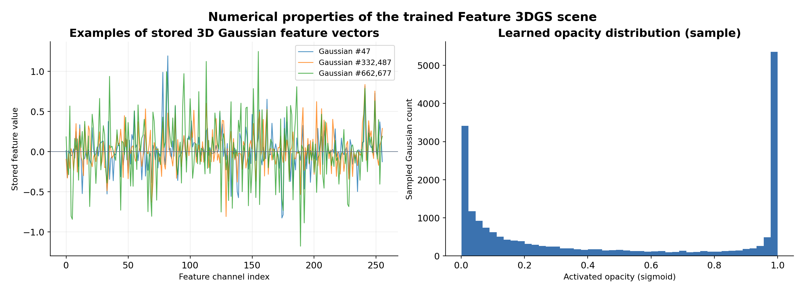

# Figures generated from the REAL Feature 3DGS experiment

These results are generated locally from your own saved tensors and model; no training is performed.

**Important:** The PCA plots are *visualizations*, not semantic labels. The Gaussian center scatter is *not* a Gaussian rasterizer image.

## 01 Real Rgb And Sam Pca



Metadata: `{"RGB source": "C:\\Users\\adnan\\ResearchData\\my_first_3dgs\\images\\20261004_133414.jpg", "SAM tensor": "C:\\Users\\adnan\\ResearchData\\my_first_3dgs\\sam_embeddings\\20261004_133414_fmap_CxHxW.pt", "PCA first 3 variance fractions": [0.1972, 0.08612, 0.08243]}`

## 02 Real Sam Feature Channels



Metadata: `{"Meaning": "Each panel is one channel F[c,:,:]; color scales are independently normalized"}`

## 03 Real Sam Selected Vector Similarity



Metadata: `{"Selected row, col": [24, 32], "Caveat": "Cosine similarity is not a mask; its values do not assign semantic labels"}`

## 04 Real Gaussian Pca Point Centers



Metadata: `{"Gaussian count": 662756, "Plotted random sample": 20000, "Semantic dimension": 256, "Caveat": "This is a sampled center scatter, not a Gaussian rasterizer output"}`

## 05 Real Gaussian Feature Profiles



Metadata: `{"Note": "Semantic vectors taken directly from semantic_* PLY properties; no SAM model was run"}`

## Interactive example using the real SAM tensor

For your MkDocs page at `docs/notes/3dgs/feature-3dgs.md`, copy `real_sam_tensor_explorer.html` into `docs/notes/3dgs/assets/` and embed it:

```html
<iframe src="../assets/real_sam_tensor_explorer.html" title="Real SAM tensor viewer" width="100%" height="1060" style="border:1px solid #cbd5e1;border-radius:12px"></iframe>
```
