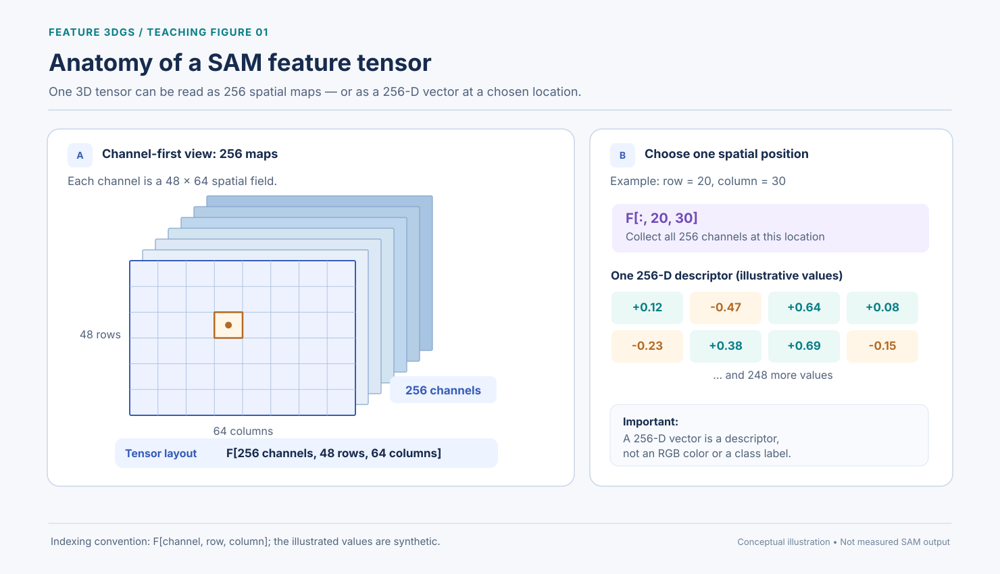
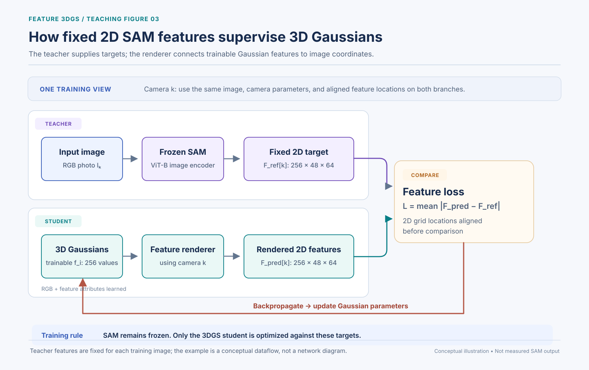
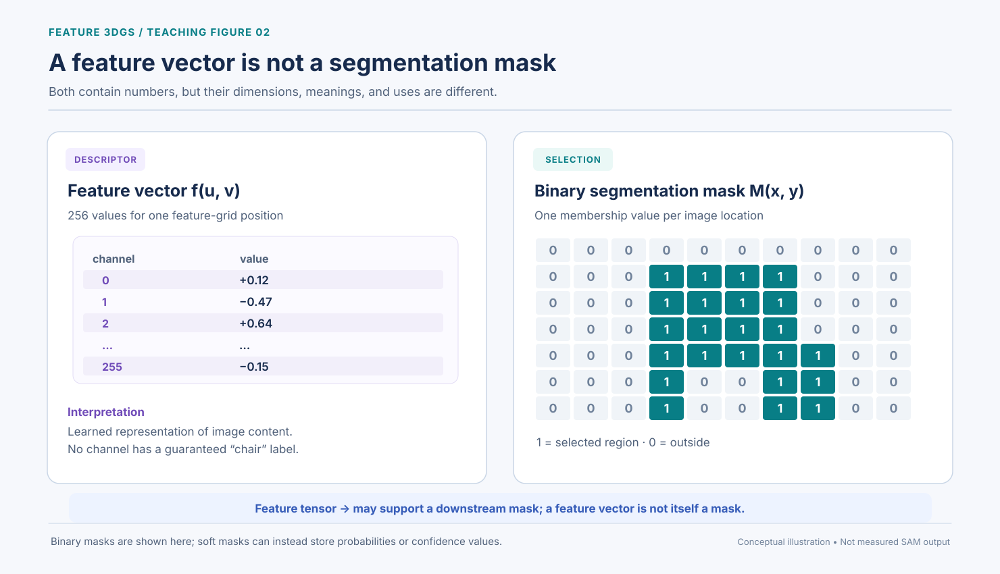
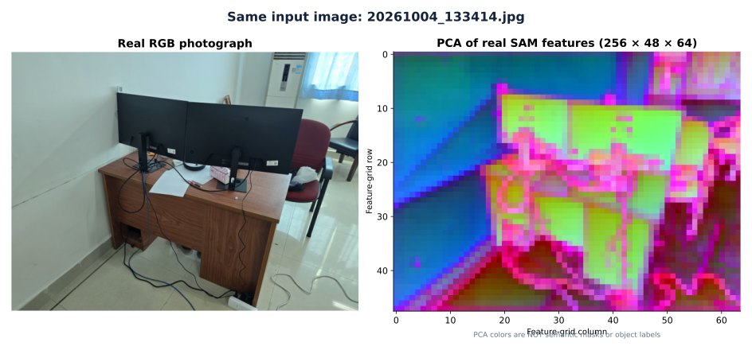
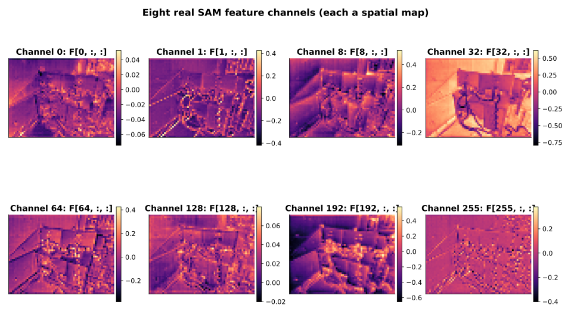
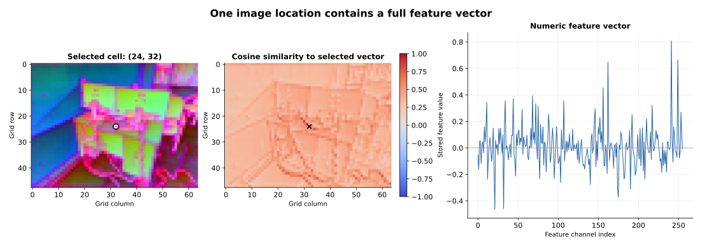
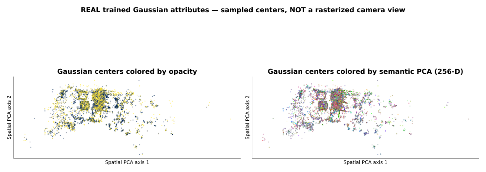
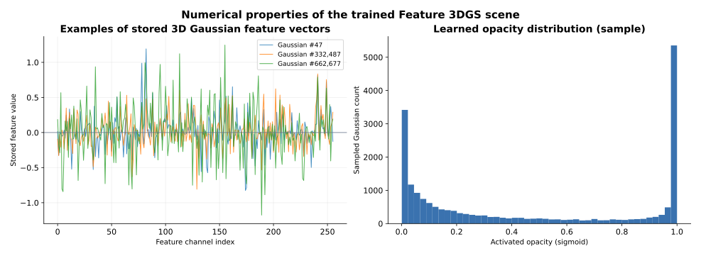

# Feature 3D Gaussian Splatting — From Motivation to Training and Inference

*An illustrated learning tutorial: understand **why** features are needed, **how** the model learns them, and **only then** examine our real trained scene.*

!!! info "Where to start"
    **Read Sections 1–9 in order.** They explain the method without relying on experimental outputs. When the training process makes sense, go to **Section 10** to interpret our five real figures, then **Section 11** for JupyterLab experiments. You do **not** need to interpret PCA images before understanding the learning process.

**Our running example:** a room with a desk, monitors, and a chair. We want to reconstruct it, then ask a question such as **“Which parts belong to the chair?”** The figures explaining the algorithm use simple, labeled teaching examples; the later experimental figures come from our actual indoor photographs and trained scene.

**Prerequisites:** [3DGS Fundamentals](fundamentals.md) and [Vanilla 3DGS](vanilla-3dgs.md). We assume you already know what Gaussian position, scale, rotation, opacity, spherical harmonics, projection, and RGB reconstruction loss mean.

## 1. Why do we need Feature 3DGS?

Think first about **Vanilla 3DGS**. We give it photographs and camera poses; it trains 3D Gaussians so that their rendering from a training camera resembles the corresponding **RGB photograph**.

That solves an appearance problem: *“What should this scene look like from here?”*

But consider a new question: **“Select the chair in this 3D room.”** A Gaussian's RGB color is not a reliable definition of a chair. The chair and monitor might both look dark; one chair could have red upholstery, metal legs, and shadows. Color alone does not encode a reusable descriptor of visual or object-related patterns.

**Our new goal** is to give each Gaussian an additional learned descriptor. When we render a scene, we then obtain not only an RGB image but also a **feature map** useful for downstream analysis.

| | Vanilla 3DGS | Feature 3DGS |
|---|---|---|
| Scene stored as | 3D Gaussians | 3D Gaussians |
| Reconstructed output | RGB image | RGB image **and** feature map |
| Primary supervision | Reference RGB photograph | RGB photograph **plus** image-encoder feature target |
| Added attribute | — | One trainable feature vector per Gaussian |
| Semantic meaning | Not explicitly encoded by RGB alone | Learned descriptors can support downstream tasks; not automatic class labels |

!!! important "Answer before moving forward"
    **Feature 3DGS does not replace the vanilla Gaussian scene. It augments the same scene representation with feature attributes.**

### Reading path after this section

| Stage | Question | Sections |
|---|---|---|
| **Motivation** | Why is Vanilla 3DGS insufficient for feature-based scene understanding? | 1 |
| **Representation** | What extra information does a Gaussian learn, and where does SAM come in? | 2–4 |
| **Learning** | How do camera views, rendering, losses, and gradients train those features? | 5–8 |
| **After training** | What is stored, and how might we request a chair mask? | 9 |
| **Real experiment** | What do our saved tensors, trained PLY, and visualizations actually show? | 10–11 |
| **Review** | Can we explain the complete process in our own words? | 12 |

---

## 2. What is new inside one Gaussian?

A Vanilla 3DGS Gaussian already has trainable position, anisotropic shape, orientation, opacity, and spherical-harmonic appearance coefficients. Feature 3DGS adds **one more learnable object**: a feature vector.

For our full-dimensional setup, Gaussian \(i\) carries

\[
\Theta_i=\{\boldsymbol\mu_i,\mathbf s_i,\mathbf q_i,\alpha_i,\mathbf c_i,\underbrace{\mathbf f_i}_{\text{256 trainable values}}\},
\qquad \mathbf f_i\in\mathbb R^{256}.
\]

A few distinctions are essential:

- \(\mathbf f_i\) belongs to the **3D Gaussian**, not to a particular photograph.
- It has **256 components**; this does **not** mean there are 256 objects or segmentation classes.
- Many Gaussians can cover the same object; there is **no guaranteed one-Gaussian-per-object correspondence**.
- The feature vector's values are learned by optimization. We do not manually write the word `chair` into the Gaussian.

Imagine a small Gaussian located on a chair armrest. It keeps its learned feature vector while different cameras view it from different angles. Later, we will see how those images provide training gradients to the **same vector**.

**One question remains:** Where will the model get its feature-learning targets? That is SAM's job.

### Interactive figure — Explore one Gaussian

Switch between **Vanilla 3DGS** and **Feature 3DGS**, click a Gaussian attribute, and change its scale, rotation, or opacity. In Feature 3DGS mode, inspect the additional **trainable 256-D feature vector**. This is a conceptual Gaussian explorer; its numerical values are illustrative.

<iframe src="../assets/gaussian_parts_explorer.html" title="Interactive Vanilla versus Feature 3DGS Gaussian attributes" width="100%" height="1480" loading="lazy" style="border:1px solid #cbd5e1;border-radius:10px;max-width:100%"></iframe>

[Open the interactive Gaussian explorer full-screen](assets/gaussian_parts_explorer.html)

---

## 3. Where does SAM fit in? — The frozen 2D teacher

In our experiment, **SAM ViT-B** serves as a **pretrained teacher image encoder**. Before Feature 3DGS training, we pass each registered RGB photograph through the SAM image encoder and save its feature tensor. We do **not** ask SAM to optimize the Gaussians or to provide their 3D positions.

We use the terminology **teacher/student** in the standard ML sense:

| Component | Job | During our Feature 3DGS training |
|---|---|---|
| **RGB photograph + camera pose** | Defines the view and RGB reconstruction target | Fixed observation |
| **SAM image encoder** | Extracts a 2D feature map from the photograph | **Frozen** |
| **Saved SAM feature map** | Provides the feature-reconstruction target for that view | **Fixed** |
| **3D Gaussians** | Render RGB and features from that camera | **Trainable** |

### Interactive figure — See exactly where SAM fits

Click the **frozen SAM encoder**, **2D teacher tensor**, **trainable 3D Gaussians**, **feature renderer**, and **loss** in order. The detail panel explains what each step receives, produces, and whether its parameters are frozen or trainable.

<iframe src="../assets/where_sam_fits_pipeline_explorer.html" title="Interactive SAM teacher and Feature 3DGS student training pipeline" width="100%" height="1470" loading="lazy" style="border:1px solid #cbd5e1;border-radius:10px;max-width:100%"></iframe>

[Open the SAM training-pipeline explorer full-screen](assets/where_sam_fits_pipeline_explorer.html)

### 3.1 What does `256 × 48 × 64` mean?

A saved teacher tensor has shape

\[
F_{\mathrm{SAM}}\in\mathbb R^{256\times48\times64}.
\]

Read the dimensions as **channels × rows × columns**:

| Dimension | Count | Meaning |
|---|---:|---|
| Feature channels | **256** | Number of components in the descriptor at a location |
| Spatial rows | **48** | Grid height |
| Spatial columns | **64** | Grid width |



*Conceptual explanation.* Think of **one grid containing 48 × 64 cells**. At every cell there is a stack of **256 numerical values**. The figure is teaching tensor indexing, not claiming these are 256 separate object masks.

### Interactive figure — Select a channel and a grid cell

Move the **channel slider (0–255)** to change the spatial map \(F[c,:,:]\). Then click any grid cell to update \(F[:,r,k]\), the **256 values at that one location**, and its cosine-similarity visualization. This is an intentionally *synthetic* tensor to teach the indexing, not a saved SAM result; the **real-tensor explorer** appears later in Section 10.4.

<iframe src="../assets/sam_tensor_explorer.html" title="Interactive synthetic 256 by 48 by 64 SAM-style feature tensor" width="100%" height="1730" loading="lazy" style="border:1px solid #cbd5e1;border-radius:10px;max-width:100%"></iframe>

[Open the 256-channel tensor explorer full-screen](assets/sam_tensor_explorer.html)

### 3.2 Channel versus vector: the two important slices

For a channel index \(c\),

\[
F_{\mathrm{SAM}}[c,:,:]\in\mathbb R^{48\times64}
\]

is a **2D map of one feature component** across the photograph. For a particular grid cell \((r,k)\),

\[
F_{\mathrm{SAM}}[:,r,k]\in\mathbb R^{256}
\]

is the **entire descriptor of that one location**.

Do not confuse the two:

- *Choose a channel* → inspect that component at **every** spatial location.
- *Choose a grid cell* → inspect **all 256 components** at one location.

### 3.3 What is a feature vector, intuitively?

In ordinary RGB, a pixel has three color coordinates \([R,G,B]\). A SAM descriptor is instead a point in a 256-dimensional **learned feature space**:

\[
\mathbf t_{r,k}=[t_0,t_1,\ldots,t_{255}].
\]

Individual coordinates may be positive or negative and generally do not have human-readable names. A descriptor is **not** an RGB color, **not** a `chair` label, and **not** a binary mask. Similar descriptors may reflect related visual structures, but similarity alone does not establish object identity.

!!! question "Check before training"
    What has 256 values here? **A teacher descriptor at one grid cell.** Does SAM copy that vector directly into a certain Gaussian? **No.** We must learn a shared 3D representation by *rendering* it and comparing predictions against these fixed 2D targets.

---

## 4. The full training idea — first see the entire learning loop

Now that we know **what we want to learn** and **who provides the target**, the rest follows the same learning pattern as Vanilla 3DGS.

### 4.1 Before optimization

We have three things:

1. **Registered photographs and cameras**, along with sparse COLMAP points used to initialize our 3D Gaussians.
2. **The fixed RGB targets**: the original photographs.
3. **The fixed SAM feature targets**: one saved 256 × 48 × 64 teacher tensor per registered image.

Each Gaussian gets trainable feature parameters in addition to its usual geometry and appearance. The Gaussian feature vectors are **initialized as parameters to optimize**, not filled by looking up one image cell and copying its SAM descriptor.

### 4.2 What happens during one training iteration?

Consider camera **A** looking toward our chair and desk:

| Step | What happens | Why it matters |
|---|---|---|
| **1. Select camera A** | Pick a registered training view. | This fixes the projection and visibility. |
| **2. Render the scene** | The same 3D Gaussians produce a predicted RGB image **and** a predicted feature map. | Both outputs come from the current student scene. |
| **3. Obtain targets** | Read the RGB photograph and its saved, fixed SAM tensor for camera A. | These are the supervision signals. |
| **4. Align resolution** | Resize the rendered feature map to the SAM target's spatial size, if needed. | Comparable tensors must describe aligned locations. |
| **5. Compute losses** | Compare RGB to RGB and rendered features to SAM features. | Measures what the student predicted incorrectly. |
| **6. Backpropagate** | Differentiate the losses through the renderer. | Produces gradients for participating Gaussian parameters. |
| **7. Update Gaussians** | Take the optimizer step, with standard Gaussian density-control behavior during training. | Improves the shared scene representation. |
| **8. Choose another camera** | Repeat with camera B, C, and other views. | The same Gaussians learn from different observations. |



**Read the diagram in two directions:** the frozen teacher branch produces the target; the **3D student branch** produces the prediction. The feature loss connects them. **Only the trainable Gaussian scene is updated**, not the pretrained SAM encoder.

### 4.3 Compare one iteration with Vanilla 3DGS

| Vanilla 3DGS | Feature 3DGS |
|---|---|
| Render RGB from camera A. | Render **RGB + features** from camera A. |
| Compare RGB with photograph. | Compare RGB with photograph **and** rendered features with saved SAM tensor. |
| Backpropagate RGB error. | Backpropagate **both** reconstruction errors. |
| Update scene Gaussians. | Update scene Gaussians, including feature vectors. |

**That is the whole algorithmic idea.** The next sections zoom into how feature rendering, feature loss, and multi-view updates work numerically.

---

## 5. How are features rendered? — Alpha compositing of vectors

Vanilla 3DGS rasterization computes a Gaussian's contribution based on projected footprint, opacity, depth order, and previously accumulated transparency. The same visibility mechanism can blend **vectors instead of RGB colors**.

For visible Gaussians sorted front-to-back at location \(p\), define

\[
\begin{aligned}
w_i(p) &= T_i(p)\,a_i(p),\\
T_i(p)&=\prod_{j<i}\bigl(1-a_j(p)\bigr),\\
\widehat{\mathbf f}(p)&=\sum_i w_i(p)\,\mathbf f_i,
\end{aligned}
\]

where \(a_i(p)\) is the **pixel-specific alpha** of Gaussian \(i\), \(T_i\) is the transmittance through nearer Gaussians, and \(\mathbf f_i\in\mathbb R^{256}\). Background handling is omitted from this compact expression.

### 5.1 A three-channel teaching example

To see the arithmetic without writing 256 terms, let each feature vector have **three** components:

\[
\mathbf f_1=[0.20,0.10,0.30],\quad \mathbf f_2=[0.80,0.50,0.20].
\]

Assume the first Gaussian has pixel alpha \(a_1=0.6\) and the second has \(a_2=0.5\). Then

\[
w_1=0.6,\qquad w_2=(1-0.6)\times0.5=0.2.
\]

The front-to-back blended prediction (zero feature background) is

\[
\begin{aligned}
\widehat{\mathbf f}&=0.6\mathbf f_1+0.2\mathbf f_2\\
&=[0.28,\;0.16,\;0.22].
\end{aligned}
\]

Notice: **the weights sum to 0.8, not necessarily 1**. The remaining transmittance is \(T_\mathrm{end}=0.2\). Weights in alpha compositing are *not* automatically normalized like probabilities in a softmax.

### 5.2 Interactive lab: change alpha, depth order, and feature values

This interactive lab shows exactly how the weights are obtained and how the rendered feature responds. Move the selected pixel, change Gaussian alpha, reverse the depth order, or perform one optimization step. The lab uses a toy three-component descriptor; the real model uses 256 components.

<iframe src="../assets/feature_blending_loss_lab.html" title="Interactive Gaussian feature blending, feature loss and gradient updates" width="100%" height="1040" loading="lazy" style="border:1px solid #cbd5e1;border-radius:10px;max-width:100%"></iframe>

[Open the feature blending and loss lab full-screen](assets/feature_blending_loss_lab.html)

---

## 6. How does the model learn these vectors? — Feature loss and gradients

We already understand an RGB reconstruction loss. Feature supervision simply adds another comparison, but the target now consists of **256-channel vectors at every feature-grid location**, not RGB intensities.

For view \(v\), denote the frozen SAM map by \(F_{\mathrm{SAM}}^{(v)}\) and the rendered Gaussian feature map by \(\widehat F^{(v)}\). An element-wise mean L1 feature loss is

\[
\mathcal L_{\mathrm{feat}}^{(v)}=
\frac{1}{CHW}\sum_{c=1}^{C}\sum_{r=1}^{H}\sum_{k=1}^{W}
\left|\widehat F_{c,r,k}^{(v)}-F_{\mathrm{SAM},c,r,k}^{(v)}\right|.
\]

Here \(C=256, H=48, W=64\) for our saved SAM targets. The renderer can initially produce a different spatial size. **The original Feature 3DGS training code bilinearly interpolates the rendered feature map to the teacher map's height and width before computing feature loss.** Matching shapes does not mean these features were computed at RGB-pixel resolution.

For the original implementation, the combined training objective is

\[
\mathcal L = (1-\lambda)\,\mathcal L_{\mathrm{RGB-L1}}
+\lambda(1-\mathrm{SSIM})
+\mathcal L_{\mathrm{feat}},
\]

where the default \(\lambda=0.2\) controls the RGB SSIM mixture and the feature L1 term has coefficient 1 in the referenced training code. The optional `--speedup` mode inserts a CNN decoder after feature rasterization; **our full 256-channel SAM training did not enable that module**.

### 6.1 Why two Gaussians receive different gradients

Take the teaching example from Section 5 and the target \(\mathbf t=[0.8,0.2,0.6]\). With the prediction \([0.28,0.16,0.22]\), the *sum* of absolute errors is

\[
\left|0.28-0.8\right|+\left|0.16-0.2\right|+\left|0.22-0.6\right|=0.94,
\]

or a **mean** absolute error of \(0.94/3\approx0.3133\). These are different reductions; training code's `l1_loss` uses the mean.

When the weights are temporarily treated as fixed, the gradient for one feature component is proportional to its compositing weight:

\[
\frac{\partial\mathcal L_{\mathrm{feat}}}{\partial f_{i,c}}=
\frac{w_i}{3}\,\operatorname{sign}(\widehat f_c-t_c).
\]

The nearer Gaussian in this example receives a larger direct feature gradient (weight 0.6 versus 0.2). In actual training, the weights themselves depend on trainable Gaussian geometry and opacity, so differentiating the *full* renderer also propagates gradients through those quantities.

**The SAM target does not move toward the student prediction. The student prediction moves toward the frozen SAM target.**

### Interactive figure — Perform a gradient update yourself

In this separate **four-dimensional toy example**, change the two Gaussian rendering weights, inspect the rendered feature and **fixed** teacher vector, then click **Run 1 gradient step** or **Run 10 steps**. Observe the student vectors change and the feature error respond. The target remains unchanged. This lab treats rendering weights as fixed during each update; in the full method they can also depend on trainable Gaussian properties.

<iframe src="../assets/feature_loss_gradient_lab.html" title="Interactive L1 feature loss and gradients on two Gaussian feature vectors" width="100%" height="1500" loading="lazy" style="border:1px solid #cbd5e1;border-radius:10px;max-width:100%"></iframe>

[Open the feature-loss gradient lab full-screen](assets/feature_loss_gradient_lab.html)

---

## 7. How do many cameras teach one Gaussian? — Multi-view feature distillation

Recall our chair. Camera A sees its front and Camera B sees its side. Because those photographs differ, the corresponding SAM feature maps also differ. But the 3D Gaussian on the chair belongs to **one common scene representation**.

Let \(\mathbf f_i\) denote that Gaussian's learned 256-D vector. Its contribution to the losses for both cameras depends on its projection, opacity, and visibility in each view:

\[
\mathcal L_{\mathrm{feat}}=\sum_{v\in\{A,B,\ldots\}}
\mathcal L_{\mathrm{feat}}^{(v)}.
\]

In practice, the training loop samples views across iterations, rather than evaluating all views simultaneously for every optimizer step. The accumulation over views in the expression above describes the overall learning objective.

**The feature vector is not copied from A and then replaced by B.** Instead, both views supply gradients to a *shared* 3D representation over training.

### 7.1 What if Camera A and B disagree?

Their target vectors need not be identical: SAM features can vary with viewpoint, visible context, partial occlusion, and image content. The model optimizes features that help explain those observations through the shared 3D Gaussians. This does **not** guarantee perfect view invariance. Occluded Gaussians typically contribute no gradient from views in which they are not visible.

### 7.2 Interactive two-camera chair lesson

Train on Camera A only, B only, or alternate between them. Observe the shared Gaussian feature vector and both view-specific losses. This is a **synthetic teaching model**, not a direct 3D correspondence evaluation on our real chair.

<iframe src="../assets/multiview_feature_distillation_lab.html" title="Interactive two-camera chair feature distillation" width="100%" height="1040" loading="lazy" style="border:1px solid #cbd5e1;border-radius:10px;max-width:100%"></iframe>

[Open the multi-view feature distillation lab full-screen](assets/multiview_feature_distillation_lab.html)

!!! question "Thought experiment"
    Camera A sees a chair leg, while Camera B cannot see it because the desk occludes it. Should the chair-leg Gaussian necessarily receive a feature gradient from Camera B? **No**: a Gaussian that does not contribute to a rendered feature pixel generally receives no direct pixel-loss gradient from that view.

---

## 8. When does learning finish? — The trained scene, not a collection of 2D predictions

Training does not store one separate 3D scene for each of our input photographs. It optimizes **one set of Gaussian parameters**, shared across all training views, for the prescribed number of iterations.

In our experiment we completed **30,000 iterations**. At the end:

- A Gaussian still has position, shape, orientation, opacity, and appearance parameters.
- It also has its **learned 256-D feature vector**.
- The trained feature attributes can be stored in the PLY as `semantic_0` through `semantic_255` (in this full-dimensional setup).
- The saved SAM tensors still belong to their respective **2D input photographs**; they are *not* 3D Gaussians.

You can now ask the model to render RGB **or features** from a camera. There is no need to rerun the training loop just to produce a feature render from a new viewpoint. For the already learned 3D feature field, rendering uses the trained Gaussian attributes.

### 8.1 What did the model learn—and what did it not learn?

**Learned:** feature descriptors distributed across persistent 3D Gaussians, trained to reproduce the frozen teacher's features across observed viewpoints.

**Not automatically learned:** a guaranteed `chair=1, everything_else=0` mask or a verified class label for every Gaussian. A feature representation enables downstream selection, but **a selection or decoding procedure is still required**.

---

## 9. After training: what can we do with the learned features?

Feature 3DGS makes it possible to render feature embeddings from a trained 3D representation. But to answer “select the chair,” additional inference logic is required.

For **SAM prompting**, the conceptual sequence is:

1. Render the learned feature map for a chosen camera view.
2. Provide a **point or bounding-box prompt**, expressed in that view's image coordinates.
3. Use SAM-compatible prompt/mask-decoding inference to produce a 2D segmentation mask from the rendered embeddings.
4. If the goal is a persistent **3D chair selection**, associate image-space evidence with the contributing 3D Gaussians, taking visibility and inconsistent evidence across views into account.

The original Feature 3DGS repository includes prompt-based segmentation scripts that consume rendered feature embeddings. Nevertheless, **obtaining a 2D prompted mask is not automatically equivalent to having ground-truth 3D object membership for every Gaussian**.

We will study and implement the 3D chair-selection step separately. This tutorial establishes exactly which quantities are available and which ones still must be inferred.

### 9.1 Why a descriptor is not a segmentation mask

This distinction matters particularly after training, when we want to select an object rather than merely render an embedding.



#### 9.1.1 What does a mask contain numerically?

A **binary segmentation mask** is a 2D array of 0s and 1s. For example,

\[
M=\begin{bmatrix}
0&0&0&0&0\\
0&1&1&1&0\\
0&1&1&1&0\\
0&0&1&0&0
\end{bmatrix}.
\]

For a selected region, 1 marks membership and 0 marks non-membership. A **soft mask** may instead contain values in \([0,1]\), expressing a confidence or a score that can be thresholded.

| Representation | Typical shape | What values mean |
|---|---|---|
| RGB image | \(3\times H\times W\) | Three color values at each image pixel |
| SAM teacher features | \(256\times48\times64\) | One 256-D descriptor per feature-grid cell |
| Gaussian feature table | \(N\times256\) | One learned 256-D descriptor for each of \(N\) 3D Gaussians |
| Rendered feature map | \(256\times H'\times W'\) | Composited descriptors in a camera view, before/after resolution alignment |
| PCA display | \(3\times H'\times W'\) | Three components **shown as colors**, not labels |
| Binary mask | \(1\times H'\times W'\) | Inclusion/exclusion of a selected region |

In SAM itself, the **image encoder's feature map** and a **mask produced by a prompt-conditioned mask decoder** are two different outputs. The Feature 3DGS training experiment distills image-encoder features. It does not directly train each Gaussian to carry a binary “chair” bit.

### 9.2 PCA is a *display technique*, not an object identifier

We cannot display 256 dimensions as an ordinary RGB image. PCA may project a collection of descriptors down to three components and map these to display colors. Such colors help examine feature structure, but **a PCA hue is not a class label or a mask value**. Different independently fitted PCAs may use entirely different color orientations.

We'll use PCA to examine our **actual saved results** next. First you now know what the model learned; only then should you interpret its visualizations.

---

## 10. Now examine our real experiment — outputs *after* understanding training

Everything above described **the learning mechanism** using equations and clearly identified toy exercises. This section changes purpose: it shows what was actually saved or computed from our own indoor room.

**Our setup:** 103 captured photographs, 99 images registered by COLMAP, 38,558 initial COLMAP points, frozen SAM ViT-B image encoder, teacher tensors of shape **256 × 48 × 64**, full 256-D feature learning without the optional `--speedup` decoder, and **30,000 training iterations**.

The sample photograph for the teacher-side figures is `20261004_133414.jpg`, showing the desk, monitors, chair, and room. **Figures 01–03 come from a 2D SAM teacher tensor. Figures 04–05 come from the trained 3D Gaussian PLY.** Both contain 256-dimensional values but refer to different stored representations.

### 10.1 Start with the photograph and its teacher feature visualization



*Real experiment, Figure 01.* The left side is the captured RGB scene. The right side shows a PCA-based pseudo-RGB display of the **fixed SAM features** for the same image. Large surfaces and boundaries are still visible, but these colored regions are **not class predictions**. The right image has only 48 × 64 samples, so it is coarser than the photograph. Do not read a particular PCA color as “chair” or “monitor”.

**Question to ask:** Can I find the approximate monitor region in both views? Probably yes. Does that mean all similarly colored locations are monitors? **No.**

### 10.2 Look inside eight individual feature channels



*Real experiment, Figure 02.* These are **eight 2D maps** extracted from one tensor: `F[0,:,:]`, `F[1,:,:]`, `F[8,:,:]`, `F[32,:,:]`, `F[64,:,:]`, `F[128,:,:]`, `F[192,:,:]`, and `F[255,:,:]`.

Notice that each still spans a spatial grid. Bright and dark patterns differ by channel; negative values are possible. **Each heatmap has its own colorbar scale**—visually equal brightness across two panels need not indicate equal numerical activation.

### 10.3 Inspect one real vector and compare it across the image



*Real experiment, Figure 03.* The selected feature-grid cell is **(row 24, column 32)**. The left panel locates the descriptor, the center measures cosine similarity with other locations, and the right plots its 256 numerical components.

For nonzero vectors \(\mathbf a,\mathbf b\),

\[
\operatorname{cosim}(\mathbf a,\mathbf b)=
\frac{\mathbf a^\top\mathbf b}{\|\mathbf a\|_2\|\mathbf b\|_2}.
\]

Look at the middle panel: much of the scene has positive similarity. **This is not a binary desk or chair mask.** A feature-similarity score measures related directions in descriptor space; even a high value does not prove two locations are the same object. We have also not verified that this selected cell lies on the chair.

### 10.4 Explore the *real* teacher tensor interactively

Choose locations and channels in the explorer below. It reads an export of the real tensor; browser values are reconstructed from 8-bit per-channel quantization, while the original `.pt` tensor contains the precise values.

<iframe src="../assets/real_sam_tensor_explorer.html" title="Interactive explorer of the real 256-channel SAM tensor" width="100%" height="1030" loading="lazy" style="border:1px solid #cbd5e1;border-radius:10px;max-width:100%"></iframe>

[Open the real SAM tensor explorer full-screen](assets/real_sam_tensor_explorer.html)

### 10.5 Inspect the actual learned 3D Gaussian features



*Real experiment, Figure 04.* A random sample of **20,000 Gaussian centers** is projected into two plot coordinates using **spatial PCA**. The left panel uses activated opacity for color; the right uses a separate **feature PCA** to turn 256-D Gaussian descriptors into display colors.

**This is not a rendered camera image.** A scatter plot draws only Gaussian centers; it does not show anisotropic splat footprints, tile visibility, or alpha-composited pixels. Moreover, Figure 01 and Figure 04 use **independent PCA fits**, so their colors are not directly comparable.

### 10.6 Inspect actual Gaussian descriptor values and opacity



*Real experiment, Figure 05.* The left graph plots 256 feature components for three saved Gaussians. The horizontal axis is **feature index**, not training time. The right graph shows **activated opacity** for sampled Gaussians, with peaks near zero and one.

This figure confirms that learned feature attributes are stored as numerical vectors and shows a distribution of opacity in the sampled scene. It does **not** identify which Gaussian is a chair part, establish accuracy of segmentation, or measure feature quality.

!!! warning "Two important distinctions"
    **Teacher side:** Figures 01–03 come from a saved **2D SAM image-encoder tensor**. **Student side:** Figures 04–05 come from the **trained 3D Gaussian attributes**. And **neither** the PCA colors nor the similarity map is a semantic segmentation mask.

---

## 11. Reproduce and inspect the real data in JupyterLab

Our example uses **103 captured photographs**, **99 COLMAP-registered images**, and **38,558 initial COLMAP points**. We trained Feature 3DGS with SAM ViT-B targets, **full 256-D features**, without the optional speed-up decoder, for **30,000 iterations**. The selected example photograph is `20261004_133414.jpg`.

The visualization script that generated the images on this page does not train or alter the model. It reads a saved teacher tensor and samples the trained PLY.

Your Windows paths are:

```python
from pathlib import Path

DATASET = Path(r"C:\Users\adnan\ResearchData\my_first_3dgs")
PLY = Path(
    r"C:\Users\adnan\ResearchData\3DGS_outputs"
    r"\my_first_3dgs_sam_30000_debug_off_GPU1_20261022_095222_761993"
    r"\model\point_cloud\iteration_30000\point_cloud.ply"
)
OUT = Path(r"C:\Users\adnan\ResearchData\3DGS_outputs\feature3dgs_real_figures")

print("PLY exists:", PLY.is_file())
print("SAM tensors:", len(list((DATASET / "sam_embeddings").glob("*_fmap_CxHxW.pt"))))
```

To examine one exact SAM tensor without quantization, load the original saved file in your trusted Python environment:

```python
import torch

path = DATASET / "sam_embeddings" / "20261004_133414_fmap_CxHxW.pt"
F = torch.load(path, map_location="cpu", weights_only=True).float()
print("Teacher tensor:", tuple(F.shape))  # (256, 48, 64)

row, col = 24, 32
v = F[:, row, col]
print("Vector shape:", tuple(v.shape))   # (256,)
print("First eight components:", v[:8].tolist())
print("One channel image:", tuple(F[0].shape))  # (48, 64)
```

To inspect the trained PLY without reloading all 256-D features into memory, use the **memory-mapped** reader in the visualization script:

```python
from make_real_feature_figures import read_feature_ply_vertices
import numpy as np

vertices = read_feature_ply_vertices(PLY)
channels = sorted(
    (name for name in vertices.dtype.names if name.startswith("semantic_")),
    key=lambda name: int(name.split("_")[-1])
)
print("Number of trained Gaussians:", len(vertices))
print("Learned feature dimensions:", len(channels))

# Read one complete 256-dimensional Gaussian descriptor.
i = 0
f_i = np.array([vertices[name][i] for name in channels], dtype=np.float32)
print("One Gaussian feature:", f_i.shape, f_i[:8])
```

These commands assume `make_real_feature_figures.py` is importable from the current notebook directory, which is how we ran the visualization kit.

!!! warning "Do not oversell a PCA picture"
    PCA is a diagnostic *projection*, not a segmentation algorithm. Even if a wall and a chair are displayed in different PCA colors, that does not prove the scene contains a correctly trained chair mask. A real object-selection evaluation needs a task-specific mask, ground truth, or consistent multi-view selection procedure.

---

## 12. Final understanding — explain the whole loop from memory

Imagine the monitor or chair in our room. Its appearance changes across input photographs. SAM extracts a fixed **256-D descriptor at each 2D feature-grid location**. Feature 3DGS maintains trainable **256-D descriptors on persistent 3D Gaussians**. For each training camera, it projects and composites visible Gaussians into a rendered 2D feature map, compares that map with SAM's fixed target, and updates the 3D representation.

The process is **not direct feature copy-paste**. It is **differentiable multi-view feature distillation**. The *last* thing we inspect is the output, after we know what produced it.

| Easy-to-confuse pair | Correct distinction |
|---|---|
| Teacher vector vs. Gaussian vector | The first is fixed in a 2D image; the second is learned and stored in a 3D primitive. |
| Feature channel vs. feature vector | A channel is one scalar over every location; a vector is all channels at one location. |
| RGB image vs. feature map | RGB has three color channels; SAM features have 256 learned channels in our setup. |
| Feature similarity vs. segmentation | Similarity is a numerical relation; segmentation requires a selection/prediction rule. |
| PCA color vs. semantic label | PCA colors encode three projection coordinates; they are not named categories. |
| Gaussian-center scatter vs. Gaussian rendering | The scatter draws centers; the renderer integrates projected splat footprints with visibility. |
| One camera vs. multiple cameras | Distinct images and feature targets supervise the same scene-level Gaussian variables. |

### Five self-check questions

1. What is the difference between `F[17,:,:]` and `F[:,24,32]`?
2. Why can the rendered feature at one pixel be a blend of several Gaussians rather than the vector of a single Gaussian?
3. If Camera A and Camera B view the same Gaussian, does the model store two feature vectors or one?
4. Does the mostly positive cosine map in Figure 03 provide a binary desk mask? Why not?
5. Why are the PCA colors in Figure 04 not directly comparable to the PCA colors in Figure 01?

**Suggested next lesson:** use rendered Gaussian features together with a 2D prompt to understand exactly how a prompt mask is produced—and which additional reasoning is needed to connect that mask to the same chair across other camera views.

---

## References and reproducibility

- Zhou et al., **[Feature 3DGS: Supercharging 3D Gaussian Splatting to Enable Distilled Feature Fields](https://feature-3dgs.github.io/)**, CVPR 2024. [Paper](https://openaccess.thecvf.com/content/CVPR2024/papers/Zhou_Feature_3DGS_Supercharging_3D_Gaussian_Splatting_to_Enable_Distilled_Feature_CVPR_2024_paper.pdf) · [Official code](https://github.com/ShijieZhou-UCLA/feature-3dgs).
- [Original `train.py`](https://github.com/ShijieZhou-UCLA/feature-3dgs/blob/main/train.py): SAM teacher target, rendered-map interpolation, RGB + feature losses, and optimizer/backpropagation.
- **Local research artifacts:** the five real-data figures generated from the saved `20261004_133414` image embedding and the trained `iteration_30000/point_cloud.ply`; generator `make_real_feature_figures.py`, plus `experiment_figure_metadata.json` for sampling and PCA provenance.

**Figure provenance:** Figures 01–03 are computed from a real *2D SAM teacher tensor*; Figures 04–05 use real *learned Gaussian attributes* from a random 20,000-Gaussian sample. Academic process diagrams and the two optimization labs explain the method using **illustrative or synthetic examples**, explicitly distinct from real measurement.
