# Fundamentals of 3D Gaussian Splatting

*An illustrated, implementation-aware explanation of vanilla 3DGS — from one Gaussian to a trained, renderable scene.*

!!! info "Who this is for"
    Assumes familiarity with ML loss functions, optimization, and gradients, **not** with camera geometry. Review [Computer Vision Fundamentals](../cv-fundamentals.md) when you encounter an unfamiliar camera or rendering term. All interactive figures are **teaching demonstrations**, not substitutes for the official CUDA renderer.

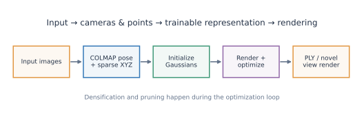

**Sections:** [1. One Gaussian](#1-what-is-one-3d-gaussian) · [2. Parameters](#2-anatomy-of-a-gaussian) · [3. Initialization](#3-from-colmap-to-initial-gaussians) · [4. Rendering](#4-how-gaussian-rendering-works) · [5. Training](#5-forward-pass-loss-and-optimizer) · [6. Multiple views](#6-learning-from-multiple-camera-views) · [7. Density control](#7-densification-and-pruning) · [8. PLY and viewers](#8-the-trained-model-ply-and-visualization)

---

## 1. What is one 3D Gaussian?

**A point specifies a 3D location; a Gaussian specifies a continuous, smoothly decreasing spatial influence around a 3D center.** A standard 3DGS Gaussian additionally carries opacity and view-dependent appearance parameters.

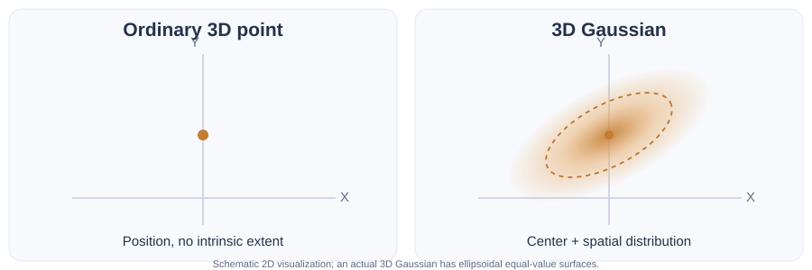

A point $\mathbf{p}=(2,1,3)$ has no intrinsic spatial size. A Gaussian at that center has a shape: spherical when *isotropic*, ellipsoidal when *anisotropic*. Ellipsoids drawn in diagrams are **equal-value surfaces**, not rigid boundaries or physical particles.

The **unnormalized 3D spatial Gaussian** used for splatting is

$$
G(\mathbf{x})=\exp\left[-\frac12(\mathbf{x}-\boldsymbol{\mu})^\top
\boldsymbol{\Sigma}^{-1}(\mathbf{x}-\boldsymbol{\mu})\right].
$$

Here $\boldsymbol{\mu}\in\mathbb{R}^3$ is the center, $\boldsymbol{\Sigma}$ is a positive-definite $3\times3$ covariance, and $\mathbf{x}$ is the 3D location at which the function is **evaluated**. At the center $G(\boldsymbol{\mu})=1$. For unit isotropic covariance, $G$ at distances $0,1,2,3$ is approximately $1.000,0.607,0.135,0.011$.

!!! warning "Do not confuse the following"
    - **Stored parameter:** e.g., center $\boldsymbol{\mu}$.
    - **Derived quantity:** e.g., covariance from stored scale/rotation.
    - **Evaluated Gaussian value:** e.g., $G(\mathbf{x})$; not a stored image pixel.
    - **Rendered pixel:** result of projecting and compositing several primitives.
    - **Ground-truth pixel:** measured RGB target from a photograph.

### Isotropic vs. anisotropic

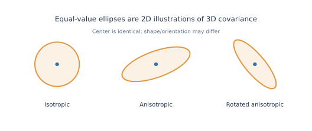

| Term | Meaning |
|---|---|
| **Isotropic Gaussian** | Equal scale in all directions: spherical equal-value surfaces. |
| **Anisotropic Gaussian** | Different scales by direction: ellipsoidal equal-value surfaces. |
| **Covariance $\Sigma$** | Describes how quickly Gaussian influence decays in different directions. |
| **Spatial support** | Mathematically extends everywhere, but becomes negligible far from the center. |

### Interactive: change the shape

<iframe src="../assets/gaussian-explorer.html" title="Interactive Gaussian scale and rotation explorer" loading="lazy" style="width:100%;height:570px;border:1px solid #d8dee8;border-radius:10px;"></iframe>

This is a **2D conceptual cross-section**. Its opacity control changes display transparency; it does not change Gaussian covariance. [Open the explorer full-screen](assets/gaussian-explorer.html).

---

## 2. Anatomy of a Gaussian

A vanilla 3DGS primitive combines **geometry**, **opacity**, and **appearance**. All can be optimized.

| Quantity | Mathematical role | In official implementation |
|---|---|---|
| **Position** $\mu=(x,y,z)$ | Center of spatial influence | Three position parameters |
| **Scale** $\mathbf{s}=(s_x,s_y,s_z)$ | Spread along Gaussian principal axes | Stored in log-scale form, activated by $\exp$ |
| **Rotation** $q$ | Orientation of principal axes | Four quaternion components, normalized for use |
| **Covariance** $\Sigma$ | Actual 3D ellipsoidal spatial distribution | Derived from activated scale and rotation |
| **Opacity** $o\in(0,1)$ | Base per-primitive opacity before footprint weighting | Stored as logit, activated by sigmoid |
| **Spherical harmonics (SH)** | Compact coefficients for direction-dependent RGB | DC and higher-order coefficients |

The core geometry relation is

$$\boxed{\boldsymbol{\Sigma}=R(q)\,\operatorname{diag}(s_x^2,s_y^2,s_z^2)\,R(q)^\top.}$$

Positive scales ensure the covariance is positive definite (in the nondegenerate case). Rotation changes *orientation*, not the center. If all three scales are equal, rotation does not change the spherical distribution.

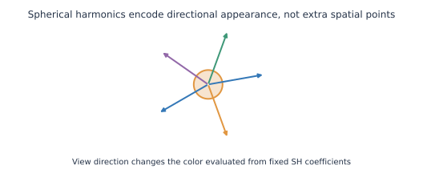

**Spherical harmonics (SH)** approximate a direction-dependent RGB function via weighted angular basis functions: $\mathbf{c}(\mathbf{d})\approx\sum_{\ell,m}\mathbf{a}_{\ell m}Y_{\ell m}(\mathbf{d})$ (with renderer-specific conventions and output adjustment). SH coefficients are **stored appearance parameters**; color for a particular viewing direction is **evaluated during rendering**. SH are not 3D spatial locations or additional Gaussians.

!!! tip "Canonical terms"
    *Mean/center* = Gaussian position. *Scale/rotation* = parameterization of covariance. *SH* = direction-dependent appearance. *Opacity* = independent learnable transparency control. Do not call the SH vector a spatial feature or confuse the Gaussian with its projected image footprint.

---

## 3. From COLMAP to initial Gaussians

The typical pipeline is **input photographs → COLMAP camera reconstruction + sparse points → initialized Gaussian primitives**.

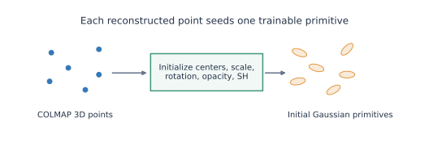

COLMAP provides **registered image poses, camera models/intrinsics, and sparse reconstructed 3D points**, often with RGB colors. It **does not** directly estimate the trainable Gaussian covariance, opacity, or SH coefficients used by 3DGS.

In the original official initialization, each COLMAP point becomes one starting primitive:

| Gaussian attribute | At initialization (typical official implementation) | Later |
|---|---|---|
| Position | COLMAP reconstructed point XYZ | Position optimized |
| Initial color | COLMAP point RGB converted to SH DC coefficient | SH coefficients optimized |
| Higher SH terms | Initialized to zero | Learned progressively |
| Scale | Estimated from nearest-neighbor distances; initially equal on three axes | Scale optimized |
| Rotation | Identity quaternion | Rotation optimized |
| Opacity | Initial activated value approximately **0.1** | Opacity optimized |

The **initial Gaussian is not empty**; it has numeric values for all those parameters. It is also **not yet correct**. Training adjusts values to match photographs. Small isolated points can eventually spawn multiple Gaussians.

!!! note "Implementation version"
    This describes the core official parameterization and initialization, not every later fork or optional extension. To verify exact initialization see [`scene/gaussian_model.py`, `create_from_pcd`](https://github.com/graphdeco-inria/gaussian-splatting/blob/main/scene/gaussian_model.py).

---

## 4. How Gaussian rendering works

**Rendering = compute an RGB image from the current Gaussian parameters and a chosen camera. It does not mean painting information into Gaussians.**

### 4.1 Project from 3D to the image

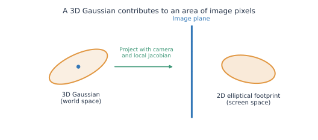

First the Gaussian center is transformed to **camera coordinates** and projected to a 2D pixel center. The 3D covariance is locally projected into an approximate 2D covariance:

$$
\boldsymbol{\Sigma}_{2D}\approx J\,W\boldsymbol{\Sigma}_{3D}W^\top J^\top,
$$

where $W$ is the 3D linear world-to-camera transform and $J$ is the local projection Jacobian (the implementation also applies rendering-specific numerical safeguards). The result is a 2D elliptical **splat footprint**. The 2D Gaussian value determines *how much this primitive influences each nearby pixel*.

**A simplified example:** for a small fronto-parallel isotropic Gaussian at depth $Z$, its projected standard deviation is approximately $s_{px}=fs/Z$. Thus, greater focal length increases apparent size; greater depth decreases it.

<iframe src="../assets/projection-explorer.html" title="Interactive 3D-to-2D Gaussian projection" loading="lazy" style="width:100%;height:490px;border:1px solid #d8dee8;border-radius:10px;"></iframe>

The interactive simplification shows projected size and center; it **does not** implement the full rotated 3D covariance projection.

### 4.2 Find pixel contributors efficiently

The renderer determines which projected footprints overlap image **tiles**, uses culling, and organizes candidate Gaussians in approximately front-to-back depth order. Only Gaussians with a sufficient footprint contribution matter for a pixel. **Tile-based rendering** is an efficiency strategy, not a change to what a Gaussian represents.

### 4.3 Compose overlapping contributions

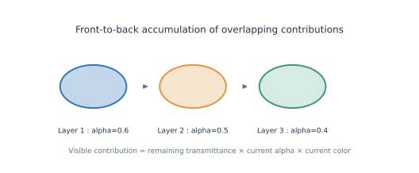

For one pixel $\mathbf{p}$, define effective alpha for Gaussian $i$ as

$$\alpha_i(\mathbf{p})=o_i\,g_i(\mathbf{p}),$$

where $o_i$ is its activated opacity and $g_i(\mathbf{p})$ is the evaluated **2D** footprint weight (practical renderers clamp/discard small values). For front-to-back ordering,

$$
T_i=\prod_{j<i}(1-\alpha_j),\qquad
\boxed{C(\mathbf{p})=\sum_i T_i\alpha_i\,c_i(\mathbf{d})+T_{\mathrm{end}}C_{\mathrm{bg}}.}
$$

Here $c_i(\mathbf{d})$ is the color evaluated from SH for viewing direction $\mathbf{d}$, $T_i$ is remaining **transmittance** before layer $i$, and the last term is background contribution. For two layers with alphas $0.6,0.5$, their weights are $0.6$ and $(1-0.6)\times0.5=0.2$; remaining background weight is $0.2$.

### Interactive: what happens when three splats overlap?

<iframe src="../assets/alpha-compositing.html" title="Interactive alpha compositing of three Gaussian contributions" loading="lazy" style="width:100%;height:440px;border:1px solid #d8dee8;border-radius:10px;"></iframe>

The demo uses fixed layer colors and lets you change the *effective per-pixel alpha*. It reveals why a rear Gaussian may be almost invisible even when its own opacity is substantial.

**Vocabulary check:** *rasterization* determines affected pixels; *depth sorting/visibility* determines order; *alpha compositing* calculates the final mixed pixel. These are related but different operations.

---

## 5. Forward pass, loss, and optimizer

The training loop shares the standard logic you know from ML, but **the learnable variables are Gaussian attributes** rather than necessarily the weights of an MLP.

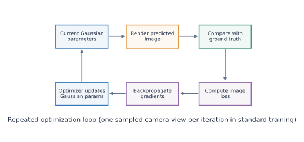

1. **Sample an observed camera/view.** Load its calibrated camera and photograph.
2. **Forward pass / render.** Predict the RGB image using the *current* Gaussian positions, scales, rotations, opacity, and SH.
3. **Compute loss.** Compare rendered prediction $\hat I$ with ground truth $I$.
4. **Backpropagate.** Differentiate image error through the differentiable renderer.
5. **Optimizer step.** Update trainable Gaussian parameters; later iterations render using updated values.
6. **Adaptive density control.** On selected training iterations, also clone, split, or remove primitives (Section 7).

The classic training objective combines per-pixel L1 and a differentiable structural-similarity term:

$$\mathcal{L}=(1-\lambda)\,\mathcal{L}_{L1}+\lambda\,(1-\mathrm{SSIM}),$$

with $\lambda=0.2$ in the original standard configuration. Particular forks and modern versions may add losses or adjustable appearance parameters.

### What changes over iterations?

| Can change | What the change can correct |
|---|---|
| Position | Place the primitive where image evidence supports it |
| Scale + rotation | Fit local spatial structure and direction |
| Opacity | Reduce or increase a primitive's visible contribution |
| SH coefficients | Fit observed color and view-dependent appearance |
| Number of Gaussians | Add details or remove redundant primitives via density control |

**Why thousands of iterations?** One image gives partial, often occluded evidence. A single optimizer update affects only the current approximation. Camera views, appearance, placement, and spatial coverage are gradually reconciled; the representation itself may gain or lose primitives.

!!! warning "The precise misconception"
    **Forward rendering does not learn new parameters.** Rendering computes the prediction. **Loss + gradients + optimizer update** perform learning. Rendering is repeated because the *parameters are updated* between iterations.

---

## 6. Learning from multiple camera views

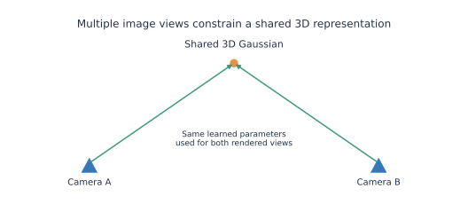

Suppose Gaussian $G_k$ is visible from cameras A and B. It has **one shared set of parameters**. Rendering from A may give gradients pushing its projected position left; rendering from B may provide a different constraint. Both update the same underlying 3D position/covariance/appearance over training.

A camera provides **2D image-space supervision**, not a ready-made correct Gaussian. Multiple views supply complementary constraints; the consistency emerges through the *shared 3D representation*. An occluded Gaussian may make little or no contribution to a given view.

**Image-space prediction vs. scene-space learning:** rendered pixel values are ephemeral outputs; Gaussian parameters persist between camera samples and optimization steps. This is the key distinction between a **rendered image** and the **trained scene**.

---

## 7. Densification and pruning

The initial sparse COLMAP cloud rarely has enough primitives to model every visible surface detail. Vanilla 3DGS therefore uses **adaptive density control**.

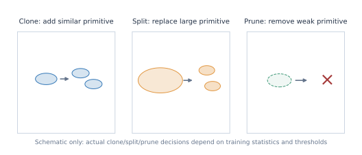

| Operation | Simplified explanation | Typical rationale |
|---|---|---|
| **Clone** | Add another primitive derived from a relatively *small* Gaussian with large positional gradient. | An under-covered region needs more capacity. |
| **Split** | Replace an overly *large* high-gradient Gaussian with smaller, spatially distributed primitives. | One broad primitive is insufficient to represent detail. |
| **Prune** | Remove primitives meeting removal criteria, notably low opacity (and size criteria in applicable configurations). | Suppress unhelpful or excessively large primitives. |
| **Opacity reset** | Periodically lower/reinitialize effective opacity in the training schedule. | Helps reorganize effective scene visibility/coverage. |

In the official implementation, densification considers accumulated **screen-space position-gradient statistics** plus scale thresholds. The distinction is more precise than simply “clone when bad, split when big.” The examples above are **schematic**; implementations differ in details.

!!! note "Density has two meanings"
    The **number/spatial concentration of Gaussians** is not the **volume attenuation density $\sigma$ in NeRF**. They should not be conflated.

This explains why a model initialized from, for example, tens of thousands of COLMAP points may eventually contain hundreds of thousands of Gaussians. **The final Gaussian count is learned representation capacity, not the number of original photos or sparse COLMAP points.**

---

## 8. The trained model, PLY, and visualization

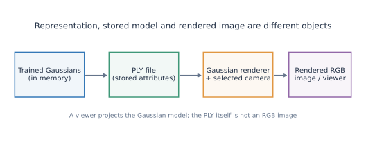

| Object | What it actually is |
|---|---|
| **3D Gaussian representation** | Collection of Gaussian geometric/appearance parameters defining the scene. |
| **`point_cloud.ply`** | A file serialization of per-Gaussian attributes. It is not a rendered picture or necessarily a traditional RGB point cloud. |
| **Rendered RGB image** | Pixels computed from the Gaussian model and a chosen camera. |
| **SIBR Gaussian Viewer** | A graphics application that visualizes the trained representation by rendering it interactively. |
| **SuperSplat** | An editor/viewer for splat representations; importing may involve compatibility/conversion requirements. |

### Typical official Gaussian PLY properties

`x,y,z` (position), `nx,ny,nz` (often placeholder normals in vanilla exports), `f_dc_0..2` (SH DC), `f_rest_*` (higher-order SH coefficients), `opacity` (raw logit in standard exports), `scale_0..2` (raw log-scales), `rot_0..3` (quaternion parameters).

!!! warning "Raw stored values vs. effective rendering values"
    The standard official PLY **stores unactivated log-scales and logit opacity**, not necessarily the effective physical scale or alpha. Conceptually: $s=\exp(\text{scale\_raw})$, $o=\operatorname{sigmoid}(\text{opacity\_raw})$; rotation is normalized for use. A PLY viewer that treats Gaussian attributes as ordinary point-cloud RGB fields can show an incomplete or misleading view.

### Experiment with your own trained `.ply`

The accompanying `scripts/inspect_gaussians.py` sample script loads a **standard 3DGS PLY**, prints Gaussian count and property names, decodes opacity/scale, and saves a sampled XY/XZ plot. It does **not** alter the model or require GPU/CUDA. Run locally using the instructions in `README_VISUAL_NOTES.md` supplied in the update ZIP.

### Check your complete mental model

1. **COLMAP point:** sparse geometric estimate used as an initialization seed.
2. **Gaussian primitive:** trainable location + ellipsoidal shape + opacity + SH appearance.
3. **Forward rendering:** project and composite the current primitives into an RGB prediction.
4. **Learning:** compare prediction to captured view; backpropagate and update Gaussian parameters.
5. **Adaptive density control:** add/remove primitives as the representation develops.
6. **PLY output:** store trained Gaussian attributes, subsequently consumed by a renderer/viewer.

**NeRF vs. 3DGS:** classic NeRF commonly queries an MLP/learned field along camera rays and integrates samples; vanilla 3DGS stores explicit Gaussians and rasterizes projected splats. Both use multi-view supervision and aim for novel-view synthesis.

## Terminology index

| Term | In one line |
|---|---|
| **Gaussian / covariance** | Continuous spatial influence / shape-orientation matrix. |
| **Isotropic / anisotropic** | Equal spread in every direction / differing directional spreads. |
| **Spherical harmonics** | Directional basis used for view-dependent Gaussian color. |
| **Splat / footprint** | One projected Gaussian contribution on an image plane. |
| **Rasterizer** | Renderer stage that finds pixels intersecting projected primitives. |
| **Tile-based / visibility-aware** | Efficient tile organization / correct treatment of depth and occlusion. |
| **Effective alpha / transmittance** | Per-pixel opacity weight / remaining visibility behind nearer layers. |
| **Optimizer / density control** | Update continuous parameters / change primitive population. |
| **Novel view** | Camera pose not used as a training image viewpoint. |

## Primary references and source code

- [Kerbl et al. — 3D Gaussian Splatting for Real-Time Radiance Field Rendering (2023)](https://repo-sam.inria.fr/fungraph/3d-gaussian-splatting/)
- [Official 3DGS repository](https://github.com/graphdeco-inria/gaussian-splatting)
- [Gaussian initialization and densification (`gaussian_model.py`)](https://github.com/graphdeco-inria/gaussian-splatting/blob/main/scene/gaussian_model.py)
- [Differentiable Gaussian rasterization implementation](https://github.com/graphdeco-inria/diff-gaussian-rasterization)
- [COLMAP output formats](https://colmap.github.io/format.html)
- [Computer Vision Fundamentals — companion page](../cv-fundamentals.md)
