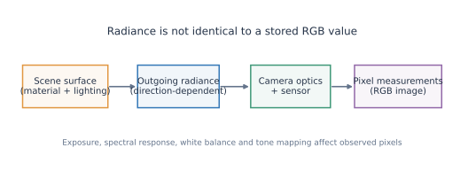
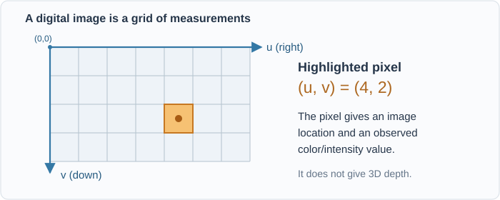
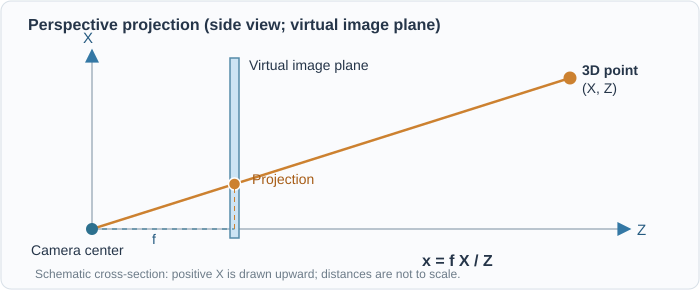
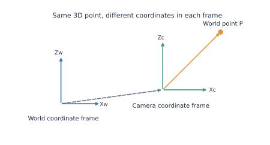
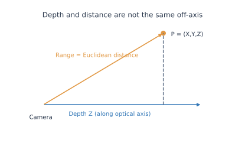
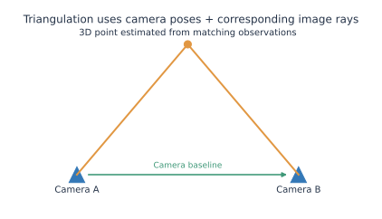
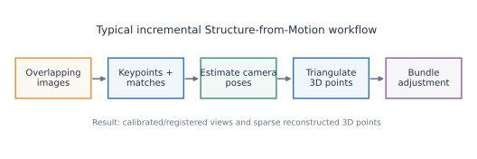
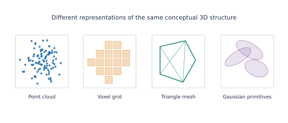
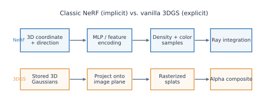
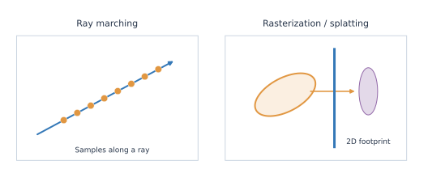

# Computer Vision Fundamentals for Machine Learning Researchers

*The camera, geometry, representation, and rendering vocabulary needed to read modern 3D reconstruction, NeRF, and 3DGS papers.*

!!! info "How to use this reference"
    You already know ML? Read the **bold definitions**, examine the figures, and try the interactive experiments. The equations add precision; the examples connect each concept to 3D reconstruction. For Gaussian-specific mechanics, continue to **[3DGS Fundamentals](3dgs/fundamentals.md)**. This is one evolving reference page, not a replacement for a CV textbook.

**Jump to:** [A. Light and images](#a-light-and-images) · [B. Cameras](#b-camera-models-and-coordinate-systems) · [C. Multiple views/COLMAP](#c-multi-view-geometry-and-colmap) · [D. Representations](#d-3d-scene-representations) · [E. NeRF](#e-neural-fields-and-nerf) · [F. Rendering](#f-rendering-and-novel-view-synthesis) · [G. Evaluation](#g-learning-and-evaluation) · [Quick glossary](#quick-reference-commonly-confused-terms)

---

## A. Light and images

**The central idea:** a digital image contains *measurements* produced by a camera; it is not a direct storage of 3D geometry or physical light fields.

| Term | Practical definition |
|---|---|
| **Image / pixel** | A sampled 2D array; a pixel is one sample location with measured or computed values. |
| **Resolution** | Image width × height, e.g., 640 × 480; spatial detail also depends on optics, scene, and sampling. |
| **RGB / color space** | Three channel values, whose interpretation depends on a convention such as linear RGB or sRGB. |
| **Radiance** | Directional light power per unit *projected area* per unit *solid angle*, with units W·m⁻²·sr⁻¹ (spectral radiance additionally has a wavelength unit). |
| **Irradiance** | Incoming light power per unit surface area (W·m⁻²), summed over directions. |
| **Reflectance / albedo** | Reflectance describes how a surface redirects incoming light; albedo generally summarizes its intrinsic reflective coloration, under a stated model. |
| **BRDF** | A function describing reflected radiance in an outgoing direction for an incoming illumination direction. |
| **View-dependent appearance** | The observed appearance changes with viewpoint: specular highlights and other direction-dependent effects are examples. |
| **Exposure / white balance** | Camera processing that changes recorded intensities or channel balance. |
| **Photometric consistency** | The idea that corresponding observations should have compatible appearance under the assumed imaging/lighting model. |

### Radiance is not the same thing as an RGB value

Radiance describes light *before camera-specific processing*. A stored pixel may additionally depend on exposure, sensor response, color conversion, tone mapping, occlusion, and noise. **For 3DGS:** learned appearance coefficients are adjusted to reproduce observed RGB images; they are not guaranteed to be calibrated physical radiance values.

### Image coordinates

We use $u$ increasing rightward and $v$ increasing downward; discrete pixel indices usually begin at the top-left. A pixel $(u,v)$ specifies an **image location**, *not* a unique world-space point. Pixel-center conventions can differ across packages.

---

## B. Camera models and coordinate systems

**The central idea:** camera geometry maps between a 3D scene point and its 2D image location.

For a point in a **camera coordinate system**, $\mathbf{P}_c=(X,Y,Z)^\top$ with $Z>0$, the idealized pinhole projection (zero skew, no distortion) is

$$
 u=f_x\frac{X}{Z}+c_x,\qquad v=f_y\frac{Y}{Z}+c_y.
$$

Here $(f_x,f_y)$ are focal lengths in pixel units and $(c_x,c_y)$ is the principal point. For example, if $X=1$, $Z=5$, $f_x=600$, and $c_x=320$, then $u=440$ pixels.

**Try it:** change depth and focal length; notice that a point's projected position is a *prediction from camera geometry*.

<iframe src="../cv-assets/pinhole-explorer.html" title="Interactive pinhole camera projection" loading="lazy" style="width:100%;height:550px;border:1px solid #d8dee8;border-radius:10px;"></iframe>

[Open the camera explorer separately](cv-assets/pinhole-explorer.html)

| Term | Practical definition |
|---|---|
| **Camera center / optical axis** | The camera's projection center and its forward-looking principal direction. |
| **Pinhole camera** | Ideal central-projection model, often used after undistorting real images. |
| **Focal length / field of view** | Focal length sets perspective scale in the image; field of view depends on focal length and sensor/image extent. |
| **Principal point** | Where the optical axis intersects the ideal image plane (under the model). |
| **Intrinsics $K$** | Camera matrix holding focal length(s), principal point, and optionally skew. |
| **Extrinsics** | Rotation and translation transforming between coordinate systems; not the same as $K$. |
| **Camera pose** | The camera's position and orientation in a chosen reference frame. |
| **World-to-camera transform** | $\mathbf{P}_c=R\mathbf{P}_w+\mathbf{t}$, for a particular convention. |
| **Camera-to-world transform** | Inverse of the world-to-camera transform; important when reading model files or using viewers. |
| **Homogeneous coordinates** | Convenient four-component representation for composing rigid/projective transformations. |
| **Projection matrix** | A matrix expression combining camera intrinsics and extrinsics, typically $P=K[R\mid t]$. |
| **Calibration** | Estimating camera parameters (typically intrinsics/distortion, and sometimes extrinsic poses). |
| **Lens distortion** | Departure from ideal pinhole projection, e.g., radial and tangential distortion. |
| **Back-projection / camera ray** | A pixel defines a ray through the camera; without depth it does not define a unique 3D point. |
| **Orthographic projection** | Projection without perspective size reduction with increasing depth; unlike standard perspective imaging. |

!!! warning "Coordinate convention matters"
    OpenCV/COLMAP image conventions and graphics/viewer conventions may differ in axis orientation, matrix layout, and camera direction. Never assume that camera-to-world and world-to-camera matrices are interchangeable. The $Z>0$ camera-forward convention here is stated for these examples.

### Depth is not always distance

**Depth $Z$** is displacement along the camera's forward axis. **Range** is Euclidean distance to the camera center, $\sqrt{X^2+Y^2+Z^2}$. Off-axis, these differ. This matters when interpreting depth maps and projecting Gaussians.

---

## C. Multi-view geometry and COLMAP

**The central idea:** corresponding observations from different camera positions allow us to estimate *both geometry and camera poses*.

| Term | Practical definition |
|---|---|
| **Viewpoint / baseline** | A camera's observing pose; baseline is separation between camera centers. |
| **Parallax / disparity** | View-dependent apparent shift of a 3D point; in rectified stereo, disparity is its horizontal pixel displacement. |
| **Feature/keypoint** | Detectable image location (e.g., a corner), typically with a descriptor for matching. |
| **Descriptor / matching** | Numeric description of image appearance and the process of finding likely correspondences. |
| **Correspondence / track** | Observations believed to originate from the same 3D point across views. |
| **Triangulation** | Estimate a 3D point using its corresponding image rays and known camera poses. |
| **Epipolar geometry** | Geometric restrictions on corresponding points between two camera views. |
| **Fundamental / essential matrix** | Matrices expressing epipolar constraints; the essential matrix assumes calibrated camera coordinates. |
| **Reprojection error** | Difference between an observed 2D feature and the projection of its estimated 3D point. |
| **Bundle adjustment** | Joint nonlinear optimization of camera parameters/poses and 3D point positions to reduce reprojection error. |
| **Camera registration** | Estimating a camera pose in the evolving reconstruction. |
| **SfM (Structure from Motion)** | Recover camera poses and typically sparse scene structure from overlapping images. |
| **MVS (Multi-View Stereo)** | Recover denser scene geometry from multiple overlapping views with known or estimated cameras. |
| **Sparse/dense reconstruction** | A relatively small set of triangulated feature points vs. geometry estimated much more densely. |
| **Depth map / point cloud** | Per-pixel distance/depth estimates vs. a set of 3D sample locations. |
| **COLMAP** | An SfM/MVS toolkit that estimates and stores camera models, image poses, and reconstructed points. |

### Interactive stereo disparity

For **parallel, rectified cameras** with baseline $B$, focal length $f$ (pixels), and depth $Z$, the ideal horizontal disparity magnitude is

$$d=\frac{fB}{Z}.$$

<iframe src="../cv-assets/parallax-explorer.html" title="Interactive stereo depth and disparity explorer" loading="lazy" style="width:100%;height:390px;border:1px solid #d8dee8;border-radius:10px;"></iframe>

### What will your COLMAP reconstruction contain?

In a typical sparse model, `cameras.bin`/`.txt` stores camera **intrinsics and camera models**; `images.bin`/`.txt` stores registered-image **poses and observations**; `points3D.bin`/`.txt` stores **triangulated 3D points and tracks**. Some newer formats also include rig/frame files. These are reconstruction estimates, not trained 3D Gaussian attributes.

**Relation to 3DGS:** the official pipeline uses the camera reconstruction and sparse points to initialize and supervise a separate collection of optimizable Gaussians.

---

## D. 3D scene representations

| Term | Practical definition |
|---|---|
| **Scene geometry vs. appearance** | Geometry describes spatial structure; appearance describes what is seen from a viewpoint under an image-formation model. |
| **Explicit representation** | Stores individual primitives (points, triangles, voxels, Gaussians), usually with their attributes. |
| **Implicit representation** | Geometry/appearance is defined by evaluating a function at arbitrary coordinates. |
| **Point cloud** | Set of 3D sample locations, optionally with color/normal observations; points have no intrinsic area. |
| **Mesh** | Connected vertices/edges/faces approximating a surface, commonly using triangles. |
| **Voxel** | A cell in a 3D grid, analogous to a pixel in 2D. |
| **Voxel grid** | Discrete 3D lattice of values or occupied cells. |
| **Occupancy field** | Function indicating whether a spatial location is occupied, possibly probabilistically. |
| **SDF (signed distance function)** | Function whose magnitude approximates distance to a surface and sign indicates side/inside-outside by convention. |
| **Volume vs. surface representation** | Models properties throughout space vs. primarily along surfaces. |
| **Continuous vs. discrete sampling** | A function can be queried at arbitrary locations even if its parameters are stored discretely. |
| **Gaussian primitive / anisotropy** | A spatially extended ellipsoidal distribution; anisotropy allows different directional spreads. |

A voxel has a finite grid cell; a point has no intrinsic spatial extent; a Gaussian has a *smoothly decaying spatial influence*. These distinctions affect rendering and optimization.

---

## E. Neural fields and NeRF

**NeRF (Neural Radiance Fields)** is a *method for representing and rendering a scene*, not a synonym for MLP or ray marching.

| Term | Practical definition |
|---|---|
| **Radiance field** | A function assigning directional radiance to locations and directions; practical neural rendering also models attenuation/volume density. |
| **Neural field** | A field whose values are computed or parameterized by a neural network/learnable feature representation. |
| **Coordinate-based network** | Predicts values from continuous coordinates rather than one fixed-size image tensor. |
| **MLP** | Multilayer perceptron; in original NeRF, an MLP maps encoded position/direction to density and view-dependent color. |
| **Positional encoding / Fourier features** | Maps coordinates to a higher-frequency feature space to help networks represent fine detail. |
| **NeRF** | Neural scene representation using a continuous radiance/density field plus differentiable volume rendering for novel-view synthesis. |
| **Volume density $\sigma$** | Nonnegative attenuation coefficient per unit distance, used in NeRF's volume-rendering model; not mass density. |
| **Transmittance $T$** | Fraction of radiance surviving attenuation along a ray, before the next interval or sample. |
| **Hash-grid encoding** | Learned multi-resolution spatial features indexed through hash tables, used to accelerate neural fields. |
| **Instant-NGP** | A neural graphics framework popularizing efficient multiresolution hash-grid encoding. |
| **View-dependent color** | Color evaluated as a function of direction, e.g., via NeRF's network or 3DGS's SH coefficients. |

!!! note "Critical distinction"
    A **radiance field** is a type of scene function. **NeRF** is one neural implementation family. A **multilayer perceptron** is one network architecture. **3DGS** instead stores explicit Gaussian primitives and view-dependent appearance parameters; it need not use a scene-wide MLP.

---

## F. Rendering and novel view synthesis

**Rendering** means generating a predicted image from a scene representation and a selected camera. **Novel View Synthesis (NVS)** means rendering the scene from a viewpoint not among the input views; this is a task, not one particular algorithm.

| Term | Practical definition |
|---|---|
| **Ray casting** | Send a geometric ray through the scene to query intersections or other spatial properties. |
| **Ray tracing** | Follow ray interactions with scene geometry; often includes secondary reflections/refractions. |
| **Ray marching** | Evaluate many discrete samples along a ray, often used for volumes or implicit fields. |
| **Volume rendering** | Integrate emission/color and attenuation along camera rays. |
| **Rasterization** | Map projected primitives to affected image pixels, then compute their contributions. |
| **Gaussian splatting** | Project Gaussian primitives to image-space footprints (splats) and accumulate their contributions. |
| **Alpha blending / compositing** | Combine overlapping contributions according to opacity and ordering. |
| **Occlusion / visibility** | Parts of a scene may be hidden by nearer contributions. |
| **Depth sorting / depth test** | Order or compare contributions by depth for correct visibility handling. |
| **Tile-based rendering** | Divide an image into tiles and process primitives affecting each tile for efficiency. |
| **Differentiable rendering** | Rendering designed so image losses can yield gradients for representation parameters. |
| **Aliasing / anti-aliasing** | Artifacts caused by inadequate sampling and methods to suppress them. |
| **Novel View Synthesis (NVS)** | Image prediction for new camera poses from a learned/reconstructed scene. |

**Compare:** NeRF typically *samples a ray*, while 3DGS *projects many Gaussian primitives onto image pixels*. Both eventually combine multiple contributions along a viewing direction.

---

## G. Learning and evaluation

| Term | Practical definition |
|---|---|
| **Observed / ground-truth image** | Captured reference image used as a supervision target (subject to camera and image quality). |
| **Predicted / rendered image** | Image generated by the current model for a selected camera. |
| **Photometric loss** | Discrepancy between predicted and observed pixels. |
| **Reconstruction vs. novel-view evaluation** | Assessment at training/known views vs. held-out viewpoints. |
| **PSNR** | Peak signal-to-noise ratio derived from pixel MSE (larger generally means lower MSE). |
| **SSIM** | Structural similarity measure comparing local brightness/contrast/structure. |
| **LPIPS** | Learned perceptual image similarity based on deep feature differences (lower typically better). |
| **Per-view supervision** | Use one input image/camera observation to update a shared 3D representation. |
| **Multi-view consistency** | Predictions from different views should agree with one coherent 3D scene. |

!!! warning "Quality metrics do not prove correct geometry"
    High image PSNR can coexist with geometric errors or poor novel-view rendering. Check both unseen views and relevant geometric diagnostics when possible.

---

## Quick reference: commonly confused terms

| Often confused | Remember |
|---|---|
| **Radiance / RGB value** | Physical directional light quantity / processed camera or rendered channel value. |
| **Radiance field / NeRF / MLP** | Field concept / neural scene method / network building block. |
| **Camera intrinsics / extrinsics** | Inside-camera projection parameters / pose transformation. |
| **Depth / range** | Optical-axis coordinate / distance from camera center. |
| **SfM / MVS** | Sparse structure and cameras / denser geometry from calibrated views. |
| **Ray marching / splatting** | Sample along rays / project and composite primitives. |
| **Volume density / Gaussian population density** | Attenuation per unit distance / number of primitives in an area or volume. |
| **Rendering / training** | Calculate image prediction / adjust parameters using its loss gradients. |
| **PLY / rendered image** | Structured stored geometric/attribute data / 2D pixel output of a renderer. |

## Try this with your own data

1. Open your COLMAP reconstruction and identify which output contains **camera intrinsics**, **registered poses**, and **sparse 3D points**. In COLMAP, exported text models are convenient for inspection.
2. Compare the meaning of a **COLMAP point** with a Gaussian primitive in your trained 3DGS `point_cloud.ply`.
3. Use the reproducible Python scripts supplied alongside these notes for static figures and a PLY inspection plot; see `README_VISUAL_NOTES.md` in the website update package.

**Next:** [3DGS Fundamentals — from one Gaussian to a complete trainable renderer](3dgs/fundamentals.md).

## Primary references

- [COLMAP: output format and reconstruction files](https://colmap.github.io/format.html)
- [COLMAP: tutorial](https://colmap.github.io/tutorial.html)
- [NeRF: Representing Scenes as Neural Radiance Fields for View Synthesis (2020)](https://arxiv.org/abs/2003.08934)
- [Instant Neural Graphics Primitives (2022)](https://nvlabs.github.io/instant-ngp/)
- [3D Gaussian Splatting for Real-Time Radiance Field Rendering (2023)](https://repo-sam.inria.fr/fungraph/3d-gaussian-splatting/)
- [Physically Based Rendering: Radiometry](https://pbr-book.org/4ed/Radiometry,_Spectra,_and_Color/Radiometry)
